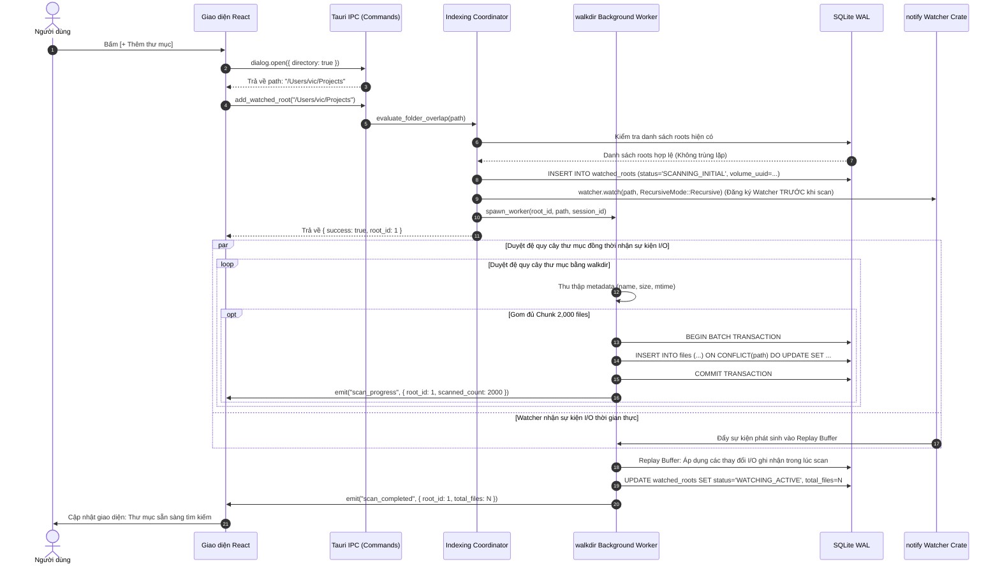
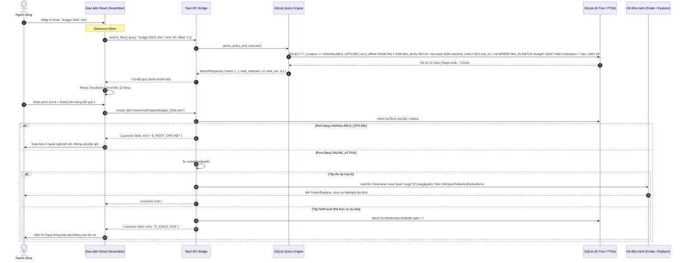

# 02. Luồng Tính năng & Logic Chuyển Trạng thái — VXSearch (`_spec2_feature_flow`)

> **Tên sản phẩm:** VXSearch (Lightweight Curated Local Folder File Search Utility)  
> **Thư mục dự án:** `vxsearch`  
> **Phiên bản tài liệu:** 1.0.0  
> **Ngày cập nhật:** 2026-10-28  
> **Tài liệu liên quan:** [00_system_overview.md](00_system_overview.md) | [01_business_process.md](01_business_process.md) | [03_ui_wireframe.md](03_ui_wireframe.md)

---

## 1. Mục đích & Phạm vi

Tài liệu này đặc tả chi tiết toàn bộ các luồng thao tác của người dùng (User Flows), sơ đồ trình tự tương tác hệ thống (Sequence Diagrams), máy trạng thái hữu hạn (Finite State Machines — FSM) và các giao ước logic máy đọc được (Machine-Readable Logic Contracts) của VXSearch ở cấp độ **Chi tiết Tính năng (Micro Feature Level)**.

---

## 2. Chi tiết các Luồng Người dùng (User Flows)

### 2.1. Luồng 1: Kích hoạt Cửa sổ Tìm kiếm từ Phím tắt Toàn cục & Khay Hệ thống
1. **Trigger (Kích hoạt):**
   - *Cách 1 (Phím tắt toàn cục):* Người dùng nhấn tổ hợp phím tắt toàn hệ thống `Cmd + Shift + F` (trên macOS) hoặc `Alt + Shift + F` (trên Windows).
   - *Cách 2 (Khay hệ thống):* Người dùng nhấp chuột trái vào biểu tượng VXSearch trên Menu Bar (macOS) hoặc System Tray (Windows), hoặc chọn mục "Mở tìm kiếm" trong menu chuột phải.
2. **Kiểm tra trạng thái cửa sổ (`WindowFSM`):**
   - Nếu `WindowFSM == HIDDEN_TRAY`:
     1. Tính toán màn hình hiển thị đang chứa con trỏ chuột hiện tại.
     2. Đặt vị trí cửa sổ ra trung tâm màn hình (Center of Screen) hoặc neo phía trên khay hệ thống.
     3. Gọi `window.show()` và `window.set_focus()`.
     4. Tự động bôi đen toàn bộ nội dung ô nhập tìm kiếm (Auto-select input text) để người dùng có thể gõ đè từ khóa mới ngay lập tức.
     5. Chuyển trạng thái sang `SEARCH_ACTIVE`.
   - Nếu `WindowFSM == SEARCH_ACTIVE`:
     1. Nếu kích hoạt bằng phím tắt toàn cục: Thực hiện ẩn cửa sổ (Toggle behavior), đưa `WindowFSM` về `HIDDEN_TRAY`.
     2. Nếu kích hoạt bằng click chuột: Đưa cửa sổ lên phía trước (Bring to front) và giữ focus.
3. **Thoát hoặc Đóng cửa sổ & Cơ chế Bảo vệ Focus:**
   - Khi người dùng bấm nút Close (chữ X trên thanh tiêu đề), nhấn phím `Escape` (khi ô tìm kiếm đang trống), hoặc click ra ngoài cửa sổ: Cửa sổ chỉ thực hiện ẩn (`window.hide()`).
   - **Ngoại lệ Giữ Cửa sổ (Modal & Native Dialog Focus Lock):** Khi người dùng đang tương tác với hộp thoại chọn thư mục của OS (`tauri-plugin-dialog`), mở menu chuột phải hoặc mở modal Settings / Folder Manager: Gán cờ `is_modal_open = true`, tạm thời vô hiệu hóa việc tự ẩn cửa sổ khi mất focus tạm thời, đảm bảo người dùng chọn file xong cửa sổ cha vẫn hiển thị nguyên vẹn.
   - Tiến trình Backend Rust vẫn tiếp tục chạy nền nhẹ nhàng trong khay hệ thống để duy trì việc giám sát tệp (`notify`).
   - Chỉ khi người dùng chọn mục **"Thoát hoàn toàn" (Quit VXSearch)** từ khay hệ thống hoặc menu ứng dụng thì tiến trình mới chấm dứt hoàn toàn.

### 2.2. Luồng 2: Quản lý Thư mục Theo dõi (Thêm, Xóa, Xem Tiến độ Quét)
1. **Mở Hộp thoại Quản lý Thư mục (Folder Manager Modal):**
   - Người dùng bấm vào nút biểu tượng Thư mục `[📂 Thư mục theo dõi]` trên thanh tiêu đề hoặc thanh công cụ.
   - Giao diện mở Modal quản lý, gọi IPC `get_watched_roots()` để lấy danh sách đầy đủ các Root kèm số lượng tệp, tổng dung lượng và trạng thái.
2. **Thêm Thư mục mới:**
   - Người dùng bấm nút `[+ Thêm thư mục]` (hoặc kéo thả folder từ desktop vào modal).
   - Hệ thống hiển thị hộp thoại chọn thư mục chuẩn OS (`tauri-plugin-dialog`).
   - Sau khi chọn folder, gửi đường dẫn xuống Backend: `add_watched_root(path)`.
   - Backend kiểm tra trùng lặp và lồng nhau qua hàm `evaluate_folder_overlap`:
     - Nếu bị trùng hoặc nằm trong thư mục cha đã có: Báo lỗi nhẹ và từ chối.
     - Nếu bao trùm các thư mục con đang có: Mở dialog hỏi xác nhận gộp.
     - Nếu hoàn toàn hợp lệ: Tạo bản ghi `watched_roots`, chuyển sang `SCANNING_INITIAL`, spawn worker `walkdir` quét nền.
   - Giao diện hiển thị thanh tiến trình quét với animation chạy sống động kèm số lượng tệp tăng dần theo thời gian thực (`scan_progress`).
3. **Xóa Thư mục khỏi Danh sách:**
   - Người dùng bấm nút biểu tượng Thùng rác bên cạnh một Root.
   - Hiển thị hộp thoại cảnh báo: *"Bạn có chắc muốn ngừng theo dõi thư mục này? Toàn bộ chỉ mục tìm kiếm liên quan sẽ được xóa sạch khỏi VXSearch (không ảnh hưởng đến tệp gốc trên máy)."*
   - Khi người dùng xác nhận: Gọi `remove_watched_root(root_id)`.
   - Backend hủy đăng ký watcher cho đường dẫn đó, chạy transaction xóa sạch các bản ghi thuộc `root_id` trong bảng `files` và xóa bản ghi trong `watched_roots`.
   - Cập nhật lại tổng số file và làm mới giao diện ngay lập tức.
4. **Quét lại Thủ công (Force Re-index):**
   - Người dùng bấm nút `[🔄 Quét lại]` bên cạnh một thư mục.
   - Backend chuyển trạng thái Root sang `RECONCILING`, thực hiện quét đối chiếu delta để cập nhật các thay đổi mới nhất mà không xóa trắng dữ liệu.

### 2.3. Luồng 3: Tìm kiếm Nhanh, Phân loại Tệp & Ảo hóa Kết quả
1. **Nhập Từ khóa:**
   - Người dùng gõ chuỗi ký tự vào ô tìm kiếm (ví dụ: `proposal q3 2026`).
   - Giao diện áp dụng debounce `50ms`. Nếu người dùng xóa sạch ô tìm kiếm (`query.trim() == ""`), bảng kết quả hiển thị danh sách các tệp được sửa đổi gần đây nhất (Recent Files) hoặc hiển thị hướng dẫn gợi ý.
2. **Chọn Bộ lọc Loại tệp (Filter Chips):**
   - Người dùng có thể click chọn nhanh các chip phân loại hoặc gõ trực tiếp phần mở rộng:
     - `Tất cả` (Mặc định): Không áp bộ lọc phần mở rộng.
     - `Tài liệu` (Documents): Lọc theo `.pdf`, `.docx`, `.xlsx`, `.pptx`, `.txt`, `.md`, `.csv`.
     - `Hình ảnh` (Images): Lọc theo `.png`, `.jpg`, `.jpeg`, `.gif`, `.svg`, `.webp`, `.heic`, `.psd`.
     - `Video & Audio`: Lọc theo `.mp4`, `.mov`, `.mkv`, `.mp3`, `.wav`, `.flac`, `.aac`.
     - `Mã nguồn` (Code): Lọc theo `.rs`, `.ts`, `.tsx`, `.js`, `.py`, `.json`, `.yaml`, `.toml`, `.html`, `.css`.
     - `Lưu trữ` (Archives): Lọc theo `.zip`, `.tar`, `.gz`, `.rar`, `.7z`.
3. **Thực thi Truy vấn SQLite Phía Backend:**
   - Backend nhận `SearchQueryPayload` và thực thi truy vấn tối ưu:
     - Khớp tên tệp không phân biệt chữ hoa/thường qua B-Tree Index hoặc SQLite FTS5 trigram.
     - Phân trang với `LIMIT 50 OFFSET 0`.
   - Trả về danh sách kết quả kèm tổng số kết quả khớp (`total_matched`) và thời gian thực thi (ví dụ: `42 kết quả (2.8ms)`).
4. **Hiển thị Ảo hóa (Virtual List Rendering):**
   - `@tanstack/react-virtual` tính toán chiều cao mỗi dòng kết quả (`44px`), chỉ render trong DOM đúng số dòng vừa khít khung nhìn (10–15 phần tử), đảm bảo cuộn cực mượt mà không tốn RAM.
   - Thẻ kết quả hiển thị: Icon loại tệp theo màu Semantic chuẩn VXUtilities, tên tệp (highlight ký tự khớp), thư mục cha mờ, dung lượng tệp (`1.4 MB`), ngày sửa đổi (`Hôm nay 09:15`).

### 2.4. Luồng 4: Điều hướng Bàn phím & Thao tác Kết quả (Keyboard-First Workflow)
VXSearch được thiết kế tối ưu cho thói quen dùng phím (Zero-Mouse Necessity):
- `Mũi tên Xuống (Down Arrow)` / `Mũi tên Lên (Up Arrow)`: Di chuyển con trỏ chọn dòng kết quả trong danh sách. Thanh cuộn tự động bám theo dòng đang chọn (`scrollIntoViewIfNeeded`).
- `Phím Enter` (hoặc nhấp đúp chuột): Mở tệp được chọn bằng **Ứng dụng Mặc định của Hệ điều hành** (`open_file(path)`).
- `Phím Cmd + Enter` (macOS) / `Ctrl + Enter` (Windows): Thực thi hành động **Reveal in Finder / Show in Explorer** (`reveal_file(path)`). Hệ thống mở thư mục chứa và bôi đen chọn chính xác tệp đó.
- `Phím Cmd + C` (macOS) / `Ctrl + C` (Windows): Sao chép đường dẫn tuyệt đối của tệp vào clipboard hệ thống (`copy_file_path(path)`), hiển thị toast thông báo nhẹ.
- `Phím Cmd + O` / `Ctrl + O`: Mở menu thao tác nhanh cho tệp đang chọn (Copy path, Open file, Reveal in folder).
- `Phím Escape`:
  - Lần 1: Nếu ô tìm kiếm đang có chữ → Xóa sạch chữ trong ô tìm kiếm.
  - Lần 2 (khi ô tìm kiếm đã trống): Ẩn ngay cửa sổ VXSearch xuống khay hệ thống.

### 2.5. Luồng 5: Quét Đối chiếu Tự động khi Khởi động lại & Máy Thức giấc (Reconciliation Walk)
1. Khi máy tính thức giấc sau giấc ngủ dài hoặc khi ứng dụng được mở lại:
2. Coordinator kiểm tra timestamp lần quét cuối cùng (`last_scan_at`) của từng Root.
3. Nếu phát hiện khoảng cách thời gian lớn hơn 60 giây (chứng tỏ app đã tắt hoặc máy ngủ):
   - Đánh dấu Root chuyển sang `RECONCILING`.
   - Sinh mã `scan_session_id = UUIDv4`.
   - Luồng nền duyệt cây thư mục bằng `walkdir`, chỉ đọc metadata `(path, size, modified_at)`.
   - So sánh với bản ghi CSDL trong RAM cache:
     - Tệp không đổi: Gán `last_seen_scan_id = scan_session_id`.
     - Tệp mới/đổi: Cập nhật metadata mới.
   - Duyệt xong: Xóa các tệp có `last_seen_scan_id != scan_session_id`.
   - Cập nhật `last_scan_at = now()`, chuyển trạng thái về `WATCHING_ACTIVE`.
   - Bắn sự kiện nhẹ `index_changed` để UI tự động làm mới nếu đang mở.

### 2.6. Luồng 6: Xử lý Ổ đĩa ngoài Tạm ngắt kết nối & Phục hồi khi Cắm lại
1. Khi người dùng rút ổ cứng ngoài (USB / External SSD):
   - Watcher phát hiện sự kiện mất kết nối hoặc coordinator kiểm tra `!root_path.exists()`.
   - Hệ thống xác định đây là phân vùng di động (Removable Drive).
   - **Cơ chế Bảo vệ Chỉ mục (Purge Protection):** Tuyệt đối không kích hoạt lệnh xóa dữ liệu của Root này khỏi bảng `files`.
   - Đổi trạng thái Root sang `UNAVAILABLE_OFFLINE`.
   - Trên UI tìm kiếm: Các tệp thuộc Root này vẫn xuất hiện khi người dùng tìm kiếm, nhưng có nhãn phụ `[Ổ ngoài ngắt kết nối]` và nút Mở bị vô hiệu hóa để tránh lỗi hệ thống.
2. Khi người dùng cắm lại ổ đĩa ngoài:
   - Coordinator phát hiện `root_path.exists()` trở lại hợp lệ.
   - Tự động kích hoạt Luồng 5 (Quét đối chiếu Delta) để cập nhật các tệp có thể đã bị sửa khi cắm ở máy khác.
   - Chuyển trạng thái Root về `WATCHING_ACTIVE`.
   - Kết quả tìm kiếm phục hồi khả năng Mở / Reveal bình thường.

---

## 3. Sơ đồ Trình tự Tương tác (Sequence Diagrams)

### 3.1. Sơ đồ Sequence 1: Thêm Thư mục & Quét Nền Đệ quy



### 3.2. Sơ đồ Sequence 2: Truy vấn Tìm kiếm & Định vị Tệp Native (Instant Search & Reveal)



---

## 4. Máy Trạng thái Hữu hạn (Finite State Machines — FSM)

### 4.1. FSM 1: Vòng đời Thư mục Theo dõi (`WatchedRootFSM`)

Mô tả các trạng thái của một thư mục nằm trong danh sách quản lý:

```text
       ┌──────────────────────┐
       │     UNREGISTERED     │
       └──────────┬───────────┘
                  │ add_watched_root(path)
                  ▼
       ┌──────────────────────┐
       │   SCANNING_INITIAL   │◄─────────────────────────────┐
       └──────────┬───────────┘                              │
                  │ Quét ban đầu hoàn tất                    │
                  ▼                                          │ Force Re-index
       ┌──────────────────────┐                              │ hoặc Relaunch
       │   WATCHING_ACTIVE    │──────────────────────────────┤
       └────┬───────────────┬─┘                              │
            │               │                                │
            │ Rút ổ ngoài   │ Lỗi truy cập (Chặn quyền)      │
            ▼               ▼                                │
 ┌──────────────────────┐ ┌──────────────────────┐           │
 │ UNAVAILABLE_OFFLINE  │ │     ERROR_ACCESS     │───────────┘
 └──────────┬───────────┘ └──────────────────────┘
            │ Cắm lại ổ đĩa
            ▼
 ┌──────────────────────┐
 │     RECONCILING      │
 └──────────┬───────────┘
            │ Đồng bộ delta hoàn tất
            ▼
 ┌──────────────────────┐
 │   WATCHING_ACTIVE    │
 └──────────────────────┘
```

- **UNREGISTERED:** Thư mục chưa được thêm vào hệ thống.
- **SCANNING_INITIAL:** Đang quét đệ quy lần đầu bằng `walkdir`. Không thể tìm kiếm các tệp chưa ghi xong.
- **WATCHING_ACTIVE:** Đã lập chỉ mục xong và đang được giám sát thời gian thực bởi `notify`. Sẵn sàng phục vụ tìm kiếm tức thì.
- **RECONCILING:** Đang quét đối chiếu delta khi ứng dụng khởi động lại hoặc khi ổ ngoài kết nối lại.
- **UNAVAILABLE_OFFLINE:** Ổ đĩa ngoài bị tháo rời. Giữ nguyên chỉ mục trong CSDL, gắn nhãn offline trên UI.
- **ERROR_ACCESS:** Đường dẫn bị đổi tên ngoài hệ thống hoặc bị chặn quyền truy cập (Permission Denied).

### 4.2. FSM 2: Vòng đời Cửa sổ Ứng dụng & Khay Hệ thống (`WindowFSM`)

```text
        ┌──────────────────────────────────────────────────┐
        │                   HIDDEN_TRAY                    │
        │  (Ứng dụng chạy ngầm trên Menu Bar / Tray,       │
        │   tiến trình Rust watcher hoạt động liên tục)    │
        └───────┬──────────────────────────────────▲───────┘
                │ Nhấn Cmd+Shift+F                 │ Nhấn Escape (query rỗng)
                │ hoặc click icon Khay             │ hoặc click ra ngoài
                ▼                                  │ hoặc bấm nút Close (X)
        ┌──────────────────────────────────────────┴───────┐
        │                  SEARCH_ACTIVE                   │
        │  (Cửa sổ nổi hiện giữa màn hình, focus SearchBar,│
        │   sẵn sàng gõ tìm kiếm và điều hướng phím)       │
        └───────┬──────────────────────────────────▲───────┘
                │ Bấm icon [📂 Thư mục]            │ Đóng Modal
                ▼                                  │
        ┌──────────────────────────────────────────┴───────┐
        │               FOLDER_MANAGER_OPEN                │
        │  (Quản lý danh sách, xem tiến độ, thêm/xóa root) │
        └───────┬──────────────────────────────────▲───────┘
                │ Bấm icon [⚙️ Cài đặt]            │ Đóng Settings
                ▼                                  │
        ┌──────────────────────────────────────────┴───────┐
        │                  SETTINGS_OPEN                   │
        │  (Sidebar cài đặt chuẩn: Updates, About, Support)│
        └──────────────────────────────────────────────────┘
```

---

## 5. Giao ước Logic Máy Đọc Được (Machine-Readable Logic Contracts)

Tất cả các hàm logic cốt lõi dưới đây phải được cài đặt chuẩn xác trong Backend Rust để đảm bảo không bị suy diễn sai lệch:

### Contract 1: Đánh giá Trùng lặp & Lồng nhau của Thư mục (`evaluate_folder_overlap`)
```rust
// Machine-Readable Specification: Path Overlap Evaluator
pub enum OverlapResult {
    Valid,                             // Hợp lệ, có thể thêm ngay
    ExactDuplicate(PathBuf),           // Trùng khớp 100% với root đã có
    ChildOfExisting(PathBuf),          // Là thư mục con của một root đã tồn tại
    ParentOfExisting(Vec<PathBuf>),    // Là thư mục cha bao trùm một hoặc nhiều root hiện có
    SymlinkLoopDetected,               // Vòng lặp liên kết tượng trưng
}

pub fn evaluate_folder_overlap(new_path: &Path, existing_roots: &[PathBuf]) -> OverlapResult {
    let canonical_new = dunce::canonicalize(new_path).unwrap_or(new_path.to_path_buf());
    
    let mut covered_children = Vec::new();
    for existing in existing_roots {
        let canonical_existing = dunce::canonicalize(existing).unwrap_or(existing.to_path_buf());
        if canonical_new == canonical_existing {
            return OverlapResult::ExactDuplicate(canonical_existing);
        }
        if canonical_new.starts_with(&canonical_existing) {
            return OverlapResult::ChildOfExisting(canonical_existing);
        }
        if canonical_existing.starts_with(&canonical_new) {
            covered_children.push(canonical_existing);
        }
    }
    
    if !covered_children.is_empty() {
        return OverlapResult::ParentOfExisting(covered_children);
    }
    
    OverlapResult::Valid
}
```

### Contract 2: Gom Sự kiện & Rút gọn Trạng thái (`coalesce_events`)
```rust
// Machine-Readable Specification: Filesystem Event Coalescer & Batch Engine
pub enum CoalescedAction {
    UpsertMetadata(PathBuf), // Cần đọc metadata và chèn/sửa bản ghi qua UPSERT
    DeleteRecord(PathBuf),   // Cần xóa bản ghi khỏi SQLite
    RenamePath { old_path: PathBuf, new_path: PathBuf }, // Cần cập nhật đường dẫn
}

pub struct CoalesceBatch {
    pub actions: Vec<CoalescedAction>,
    pub has_gap: bool,       // true nếu hàng đợi bị tràn hoặc kernel mất sự kiện
}

pub fn coalesce_events(
    raw_events: Vec<notify::Event>, 
    db_lookup_exists: impl Fn(&Path) -> bool
) -> CoalesceBatch {
    // 1. Giới hạn dung lượng Bounded Queue tối đa 50,000 events; nếu tràn gán has_gap = true
    // 2. Dùng HashMap để gom nhóm theo canonical path
    // 3. Nếu Create rồi Remove trong cùng batch:
    //    - Nếu db_lookup_exists(path) == false -> Triệt tiêu thành No-op
    //    - Nếu db_lookup_exists(path) == true -> Chuyển thành DeleteRecord(path)
    // 4. Nếu Modify liên tiếp -> Giữ đúng 1 UpsertMetadata tại thời điểm cuối
    // 5. Chuỗi atomic save (.tmp -> rename đè file gốc) -> Chuyển thành UpsertMetadata(target_path)
    // 6. Cắt batch tối đa 2,000 actions cho mỗi SQLite Write Transaction
    CoalesceBatch { actions: Vec::new(), has_gap: false }
}
```

### Contract 3: Phân tích & Xây dựng Câu truy vấn Tìm kiếm (`build_search_query`)
```rust
// Machine-Readable Specification: Search Query Builder & Grammar Parser
pub struct SearchParams {
    pub query: String,                   // Đồng bộ với IPC query
    pub filter_type: Option<String>,     // "all", "document", "image", "video", "audio", "code", "archive"
    pub root_id: Option<i64>,
    pub sort_by: Option<String>,         // "relevance", "name_asc", "size_desc", "modified_desc"
    pub limit: usize,                    // Mặc định 50
    pub offset: usize,                   // Mặc định 0
}

pub fn build_sql_query(params: &SearchParams) -> (String, Vec<rusqlite::types::Value>) {
    // Phân tích cú pháp:
    // 1. Tách chuỗi query đã normalize Unicode (NFC):
    //    - Trích xuất token có đuôi .ext nếu có
    // 2. Phân luồng độ dài chuỗi (Xử lý giới hạn trigram < 3 ký tự):
    //    - Nếu query sạch < 3 ký tự:
    //      Sử dụng B-Tree Index trên bảng files:
    //      SELECT f.*, (r.status == 'UNAVAILABLE_OFFLINE') as is_offline
    //      FROM files f JOIN watched_roots r ON f.root_id = r.id
    //      WHERE f.name_lower LIKE ? || '%' OR f.name_unaccent LIKE ? || '%'
    //    - Nếu query sạch >= 3 ký tự:
    //      Sử dụng FTS5 Trigram JOIN bảng files:
    //      SELECT f.*, (r.status == 'UNAVAILABLE_OFFLINE') as is_offline
    //      FROM files f
    //      JOIN files_fts fts ON f.id = fts.rowid
    //      JOIN watched_roots r ON f.root_id = r.id
    //      WHERE files_fts MATCH ?
    // 3. Kết hợp điều kiện filter_type ánh xạ sang tập extension chuẩn
    // 4. Áp dụng ORDER BY theo sort_by (mặc định relevance: bm25(files_fts) hoặc modified DESC)
    // 5. LIMIT ? OFFSET ?
    (String::new(), Vec::new())
}
```

### Contract 4: Điều hướng Mở & Highlight Chuẩn Native (`reveal_in_file_manager`)
```rust
// Machine-Readable Specification: Cross-Platform Native Reveal & Safe Stale Cleanup
pub enum RevealResult {
    Success,
    StaleFileDeleted,
    RootOffline,
    AccessDenied(String),
    LaunchError(String),
}

pub fn reveal_in_file_manager(
    target_path: &Path, 
    root_status: &str,
    mut delete_stale_record: impl FnMut(&Path)
) -> RevealResult {
    // 1. Kiểm tra trạng thái root
    if root_status == "UNAVAILABLE_OFFLINE" {
        return RevealResult::RootOffline;
    }

    // 2. Kiểm tra sự tồn tại qua fs::metadata
    match std::fs::metadata(target_path) {
        Ok(_) => {
            // Tệp tồn tại hợp lệ -> Gọi OS Reveal
            #[cfg(target_os = "macos")]
            {
                // Trên macOS: Command::arg truyền literal an toàn, không dùng shell string
                let status = std::process::Command::new("open")
                    .arg("-R")
                    .arg(target_path)
                    .status();
                match status {
                    Ok(s) if s.success() => RevealResult::Success,
                    Ok(_) => RevealResult::LaunchError("Lệnh open -R trả về lỗi.".into()),
                    Err(e) => RevealResult::LaunchError(e.to_string()),
                }
            }
            #[cfg(target_os = "windows")]
            {
                // Trên Windows: Gọi Win32 SHOpenFolderAndSelectItems hoặc fallback explorer.exe /select,
                let status = std::process::Command::new("explorer.exe")
                    .arg(format!("/select,\"{}\"", target_path.to_string_lossy()))
                    .status();
                match status {
                    Ok(_) => RevealResult::Success,
                    Err(e) => RevealResult::LaunchError(e.to_string()),
                }
            }
        }
        Err(e) if e.kind() == std::io::ErrorKind::NotFound => {
            // CHỈ XÓA KHI ROOT ĐANG ONLINE VÀ TỆP THỰC SỰ NOT FOUND
            if root_status == "WATCHING_ACTIVE" || root_status == "SCANNING_INITIAL" {
                delete_stale_record(target_path);
                RevealResult::StaleFileDeleted
            } else {
                RevealResult::RootOffline
            }
        }
        Err(e) => RevealResult::AccessDenied(e.to_string()),
    }
}
```
